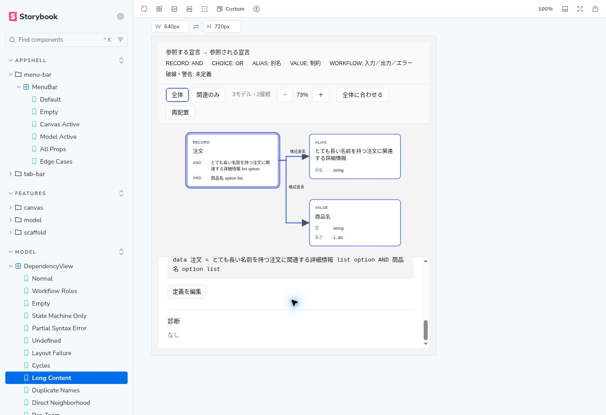

# モデル依存図 — 受入検証記録（#286）

自動検証日: 2026-10-18（#313） / ブラウザ確認追記: 2026-10-24。

追記の対象: `2791e990693fc0409ba6733107b1e98312049e1e`（#313マージ後のmain）。

## 検証範囲と判定

Vitest（happy-dom）で実際のDSL解析・参照解決・図生成・配置・編集履歴・文書セッションを通す。ファイルIPCとDOM寸法だけをフェイクにする。以下の「自動」はこの範囲の確認を指し、ブラウザの描画やOSの実ファイル監視を検証した意味ではない。

2026-10-18は、ローカルChromeがなく、公式Chromium配布のダウンロードとクラウドブラウザから開発サーバーへの接続に失敗し、表示確認を実施できなかった。2026-10-24は公開済みのmainのStorybookをクラウドChromeで操作し、ライト表示・連続キーボード・狭い表示・異常状態の確認を追加した。取得画像と手順は後述する。

ダーク表示、アプリ全体のブラウザ操作、Tauri実機、表示応答の計測は未完了。Storybookで確認した範囲をアプリやOSの受入済みとは扱わない。今回はローカルのplaywright-cliではなく、クラウドブラウザの操作APIを使用した。

## 受入条件と自動テストの対応

表のファイル名は直下のリンク一覧で配置を特定できる。テスト名には検証する振る舞いを記している。UI-08はDOMの文字列検証だけではレイアウトの合否を判断できない。

| ID | 確認内容 | テスト | 結果 |
| --- | --- | --- | --- |
| UI-01 | 選択の両方向の直接接続だけを強調 | dependencyView.selection.test.tsx | 自動確認 |
| UI-02 | workflowの入力・出力・エラーを文字と方向で区別 | dependencyView.normal.test.tsx | 自動確認 |
| UI-03 | 別ノード選択で直接近傍へ更新 | dependencyView.related.test.tsx | 自動確認 |
| UI-04 | 全体復帰時に全ノード・辺と選択を復元 | dependencyView.related.test.tsx | 自動確認 |
| UI-05 | 実エディタの宣言範囲へ移動・フォーカス | modelDiagnostics.dependency-navigation.test.tsx | 自動確認 |
| UI-06 | 未定義の架空本文を出さず役割別参照箇所へ移動 | modelDiagnostics.dependency-navigation.test.tsx | 自動確認 |
| UI-07 | 最初のフォーカス以降、Tab・Enter・Spaceで選択→関連のみ→定義編集→図へ復帰 | modelDiagnostics.dependency-keyboard.test.tsx / DependencyKeyboard story | 自動確認。クラウドChromeの連続キー操作も確認 |
| UI-08 | 狭いウインドウで操作・詳細の重なりを防ぎ全文を閲覧 | LongContent story / dependencyCardBody.normal.test.tsx | 文字列の保持は自動確認。640×720のライト表示で折り返し・スクロール確認。ダークは未確認 |
| CORE-01 | 受入サンプル9ノード・9辺、直接近傍5ノード・4辺 | model-graph.normal.test.ts | 自動確認 |
| CORE-02 | 同じ対象の複数役割・位置を1辺へ保持 | model-graph.normal.test.ts | 自動確認 |
| CORE-03 | AND・OR・修飾順・制約を保持 | model-graph.normal.test.ts | 自動確認 |
| CORE-04 | 後方定義への参照 | model-graph.normal.test.ts | 自動確認 |
| CORE-05 | 未定義ノードを共有して全参照を保持 | model-graph.edge.test.ts | 自動確認 |
| CORE-06 | 循環・自己参照の全辺を保持し停止 | model-graph.edge.test.ts | 自動確認 |
| CORE-07 | 重複名は先頭へ解決し後続の診断を保持 | model-graph.edge.test.ts | 自動確認 |
| CORE-08 | マシンのイベント名を型参照にしない | model-graph.edge.test.ts | 自動確認 |
| CORE-09 | 対象外宣言への解決を未定義と混同しない | model-graph.edge.test.ts | 自動確認 |
| CORE-10 | 破損宣言後の正常宣言を保持 | model-graph.edge.test.ts | 自動確認 |
| SYNC-01 | 表示・モード・閲覧操作で保存本文を変えない | dependency-sync.integration.test.tsx / dependency-acceptance.integration.test.tsx | 自動確認 |
| SYNC-02 | マシンとの往復で選択・表示範囲・パン・ズームを保持 | dependency-sync.integration.test.tsx | 自動確認 |
| SYNC-03 | 本文の追加削除・リネーム・スタブ生成を反映 | dependency-sync.integration.test.tsx / dependency-sync.editing.test.tsx | 自動確認 |
| SYNC-04 | 本文と同じUndo/Redoで図を復元 | dependency-sync.integration.test.tsx / dependency-sync.editing.test.tsx | 自動確認 |
| SYNC-05 | 外部変更後に古い計測が届いても最新本文を維持 | dependency-sync.external.test.tsx | 自動確認 |
| SYNC-06 | 対象削除・識別不能時は選択解除し全体へ復帰 | dependency-sync.integration.test.tsx / dependency-sync.editing.test.tsx | 自動確認 |
| SYNC-07 | 未定義名のスタブ生成で定義ノードへ置換 | dependency-sync.editing.test.tsx | 自動確認 |
| SYNC-08 | 先頭行追加後も最新の編集位置へ移動 | dependency-sync.external.test.tsx | 自動確認 |
| SYNC-09 | タブごとのノード・選択・詳細・表示位置の独立 | dependency-sync.integration.test.tsx | 自動確認 |
| SYNC-10 | 保存・再読込で参照方向と役割を復元。初回保存の失敗から再試行可能 | dependency-acceptance.integration.test.tsx / dependency-sync.integration.test.tsx | 自動確認 |
| SYNC-11 | 読み込み・UTF-8復号失敗で採用済み本文を保持 | dependency-sync.external.test.tsx | 自動確認 |
| SYNC-12 | 外部から採用した部分ASTと診断を同じ本文で表示 | dependency-sync.external.test.tsx | 自動確認 |

テストの配置:

- [コア正常系](../../../packages/model-core/src/model-graph/__tests__/model-graph.normal.test.ts) / [コア境界・異常系](../../../packages/model-core/src/model-graph/__tests__/model-graph.edge.test.ts)
- [依存図の画面テスト](../../../apps/desktop/src/features/model/components/dependency-view/__tests__) / [カード本文テスト](../../../apps/desktop/src/features/model/components/dependency-view/card/__tests__/dependencyCardBody.normal.test.tsx)
- [実エディタへの移動](../../../apps/desktop/src/features/model/components/model-diagnostics/__tests__/modelDiagnostics.dependency-navigation.test.tsx) / [キーボード](../../../apps/desktop/src/features/model/components/model-diagnostics/__tests__/modelDiagnostics.dependency-keyboard.test.tsx)
- [文書同期・保存・タブ](../../../apps/desktop/src/appShell/__tests__/dependency-sync.integration.test.tsx) / [編集](../../../apps/desktop/src/appShell/__tests__/dependency-sync.editing.test.tsx) / [外部変更](../../../apps/desktop/src/appShell/__tests__/dependency-sync.external.test.tsx)
- [新規文書の初回保存・再読込と保存失敗](../../../apps/desktop/src/appShell/__tests__/dependency-acceptance.integration.test.tsx)

## 再現コマンド

Node.js 24、`pnpm@10.33.0`を使用し、リポジトリルートで実行する。

```bash
pnpm install --frozen-lockfile
pnpm typecheck
pnpm exec biome check
pnpm lint
pnpm run check:boundaries
pnpm test:run
pnpm build
pnpm build-storybook
```

依存図と文書シナリオだけを実行する場合:

```bash
pnpm --filter @domain-modeler/desktop exec vitest run dependency model-graph model-modes new-document
```

既存エディタ・ステートマシン・保存の回帰は、全体テストと `model-modes*.integration.test.tsx`、`new-document.integration.test.tsx` も通して確認する。Rustの変更はない。macOS / WindowsのRust CI結果とTauri実機操作は別の検証とする。

## #313の自動検証結果（2026-10-18）

- TypeScript型チェック、Biome、oxlint、モジュール境界検査: 成功。
- Vitest: **352ファイル・2494テスト成功**。新規文書の初回保存・保存失敗、連続キーボード操作、3規模の計測文書を追加。
- Viteの本番ビルド、Storybookの静的ビルド: 成功。ビルド成功を表示確認の代わりにはしない。
- Rust / Tauri実機、スクリーンショット、表示応答計測: 未実施。Issueの受入全体を完了扱いにしない。

## ブラウザ確認の追記（2026-10-24）

[mainのStorybookデプロイ](https://github.com/DIO0550/domain-modeler/actions/runs/39967795301)が対象コミットで成功したことを確認し、[公開Storybook](https://dio0550.github.io/domain-modeler/)を使用した。マージ時に削除されたPR #313のプレビューは404になるため、今回の再現先には使用しない。

環境はクラウドChrome、ライト表示。取得画像は1363×936px。StorybookのViewport sizeでプレビューを1280×720pxまたは640×720pxに設定した。ChromeのバージョンとホストOSは未取得であり、性能測定には使用していない。

| ケース | 操作・観測結果 |
| --- | --- |
| Normal | 注文を選択し、依存先・参照元・定義を確認。「関連のみ」で5モデル・5接続から5モデル・4接続へ変化し、選択と直接接続が強調された |
| Workflow Roles | 2モデル・1接続に入力・出力・エラーの3役割と、カードの`注文 list option`を表示 |
| DependencyKeyboard（1280×720） | 最初の「依存図」クリック後はフォーカスを移し直さず、実際のTab・Shift+Tab・Enter・Spaceで注文選択→関連のみ→商品選択→定義編集→図へ復帰。編集欄にフォーカスがあり、選択文字列が`data 商品 = string`であることを確認。復帰後も商品選択と2モデル・1接続の関連表示を保持 |
| LongContent（640×720） | 注文を選択→全体に合わせる→詳細欄をスクロール。ツールバーが折り返され、詳細欄は図の下へ配置された。長い日本語と`list option`・`option list`を保持し、定義全文と「定義を編集」をスクロールで閲覧できた |
| Empty / StateMachineOnly | 0モデル・0接続、data・workflowがない旨と「定義画面へ戻る」を表示。ズーム・配置操作は無効 |
| Undefined | 3モデル・2接続。未定義2件を破線カード・警告・診断一覧で表示 |
| PartialSyntaxError | 先頭の構文エラー後も注文・不明な注文・数量の3モデル・1接続を表示し、エラー1件・警告1件を併記 |
| Cycles | 木の自己参照、AとBの循環、孤立モデルを含む4モデル・3接続が表示され、処理が停止しない |
| LayoutFailure | 配置失敗の理由と「再試行」「定義画面へ戻る」を表示。Storyの寸法計測は意図的に失敗するため、正常配置への復旧は未確認 |

独立したDependencyViewのStoryは定義移動コールバックを代替している。Empty等の「定義画面へ戻る」は入口の表示確認にとどまり、実エディタへの移動はModelDiagnosticsのキーボード往復で確認した。異常状態からの復旧操作全体は未確認。

キーボード往復は次の順でキーを送った。各段階のフォーカス先と画面の変化を確認し、途中で対象ボタンを指定してフォーカスし直していない。

```text
「依存図」をクリック
Tab×6 → Enter（注文選択）
Shift+Tab×5 → Space（関連のみ）
Tab×6 → Space（商品選択）
Tab×3 → Enter（定義を編集）
Shift+Tab×3 → Enter（依存図へ復帰）
```

画像取得にはクラウドブラウザの`tab.screenshot()`を使用した。640×720のプレビューで選択・フィット後、詳細欄を下へスクロールした画像を添付する。



関連テストもdesktopのVitest設定で再実行し、**54ファイル・297テスト成功**を確認した。

```bash
pnpm --filter @domain-modeler/desktop exec vitest run dependency model-graph model-modes new-document
```

Rust CIは対象コミットの[macOS / Windows実行](https://github.com/DIO0550/domain-modeler/actions/runs/39967795328)が成功している。ただし、CI成功をTauriの保存ダイアログ・実ファイル監視・IME・トラックパッド操作の確認とは扱わない。

## 性能計測

計測文書は[フィクスチャ](../../../apps/desktop/src/features/model/components/model-diagnostics/__tests__/dependency-performance.test-support.ts)で生成する。1組は10宣言・13辺（ALIAS4、RECORD2、CHOICE2、VALUE1、WORKFLOW1）。日本語名・AND・OR・list / option・範囲制約・workflowの3役割を含み、複数組は非連結成分になる。最大500宣言まで欠落・診断なしで配置できることを通常のテストでも確認する。これは任意の500宣言文書を保証する上限ではない。高密度グラフ・非常に長い単一宣言・1000宣言以上は未測定。

```bash
pnpm --filter @domain-modeler/desktop exec vitest bench --run dependency-performance --outputJson=dependency-benchmark.json
```

2026-10-18、Ubuntu 24.04.3、AMD EPYC 9V74（実行環境から9論理CPU、メモリ10GiBが見える）、Node.js 24.19.0、Vitest 4.1.4 / happy-dom 20.8.9。各ケース200msウォームアップ後、500ms以上・最低10サンプル。カード寸法は280×220pxに固定。解析・参照解決・カード生成・配置のCPU区間を計測した。DOM描画、フォント計測、React更新、画面へのpaint、ファイルI/Oは含まない。

| 宣言 / 辺 | UTF-8バイト数 | サンプル数 | 平均ms | p99 ms | 最大ms |
| --- | --- | --- | --- | --- | --- |
| 10 / 13 | 504 | 4980 | 0.1004 | 0.3265 | 0.7622 |
| 100 / 130 | 5049 | 244 | 2.0574 | 3.2411 | 4.7964 |
| 500 / 650 | 26169 | 10 | 58.8857 | 62.0043 | 62.0043 |

CPU区間の再計測時の目安は同等環境で100宣言p99 10ms以内、500宣言p99 100ms以内とする。今回のCPU測定はこの範囲に収まるが、CI共有マシンでは厳密な時間アサーションを行わない。

**表示応答は未計測・未達成判定**。必要な暫定目標は100宣言の初回表示500ms以内、選択・関連表示200ms以内（各p95）。同じ環境・ブラウザ・表示寸法でウォームアップ2回と本計測20回を行い、入力イベントから、期待ノード・辺が揃った後の2回目のrequestAnimationFrameまでを計る。OS・CPU・ブラウザ/WebViewバージョン・テーマ・viewport・文書バイト数と分布を記録する。モジュールロードを含むコールド起動は別に計る。500宣言の表示目標は実測後に設定する。

## 未確認のブラウザ・実機項目

次の範囲は引き続き未確認。完了時に環境・操作・結果・スクリーンショット取得コマンドを追記する。

| 環境・条件 | 操作と確認点 |
| --- | --- |
| アプリ全体のブラウザ操作、1280×720以上、ライト/ダーク | Storybookの部品単位確認とは別に、新規文書へ受入サンプルを入力→依存図→選択→関連のみ→別モデル→全体→定義を編集→図へ戻る |
| ダーク表示（1280×720以上 / 640×720） | カード・線・ラベル・選択枠・長い日本語の可読性、ツールバーとインスペクターの非重複。ライトの結果で代用しない |
| ブラウザの異常状態からの復旧 | 空・構文エラーから定義画面へ戻って修正、正常な寸法計測で配置再試行。今回の確認は異常状態の表示と復旧入口まで |
| Tauri macOS / Windows | 新規・既存文書→図の閲覧→保存→閉じる→再度開く。本文に図の座標等が混ざらず参照が同じ、表示状態は初期化 |
| Tauri実ファイル監視 | 外部エディタで正常・破損・未定義の本文へ変更。未保存編集との競合の採用/保持、IME中の遅延、読み込み失敗後の復旧 |
| Tauriのマウス・トラックパッド | 4pxのパン閾値、ホイール/2本指パン、Ctrl/⌘付きwheel/ピンチ、ズーム後の選択と参照移動 |
| 表示性能 | 上記の20回測定。CPU測定値で代用しない |

表示確認の取得例（`pnpm dev` / `pnpm storybook`起動後）:

```bash
playwright-cli open http://localhost:14000
playwright-cli resize 1280 720
playwright-cli screenshot --filename=dependency-desktop.png
playwright-cli goto 'http://localhost:6006/iframe.html?id=model-dependencyview--long-content'
playwright-cli resize 640 720
playwright-cli screenshot --filename=dependency-narrow-light.png
```

これはローカル環境での再実行用の例であり、今回クラウドブラウザで実行したコマンドではない。ダーク表示はブラウザの`prefers-color-scheme`をdarkに設定してから確認する。現在のCSSはこのメディアクエリで切り替わり、Storybookの`globals=theme:dark`だけではダークにならない。定義編集への移動やテーマ切替はStorybook上だけでなくアプリでも確認する。
